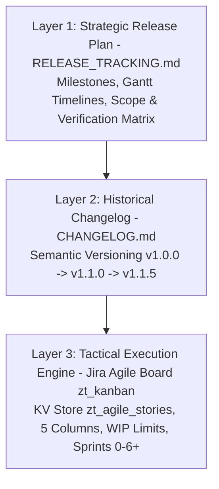
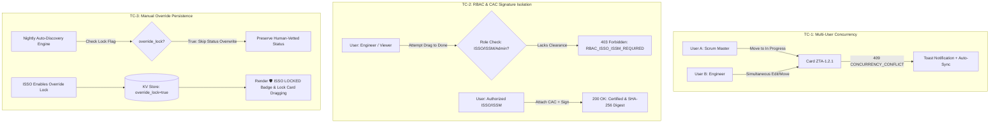
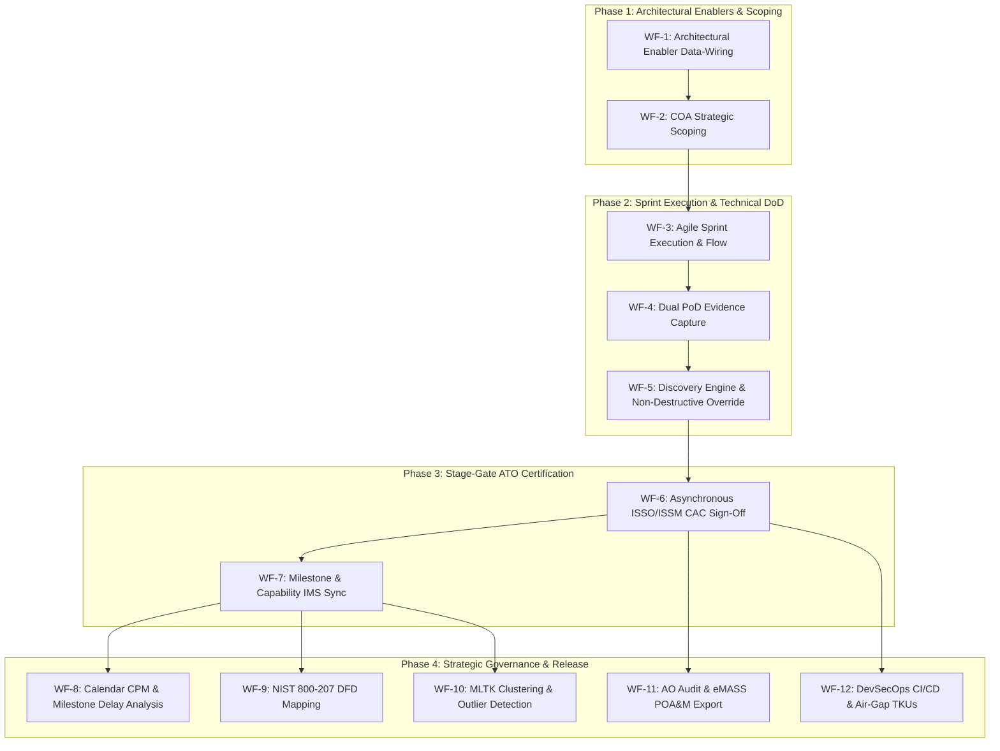

# Release Tracking & Knowledge Base: DoD Zero Trust Compliance Platform

**App Package:** `zero_trust_compliance`  
**Current Release:** `v1.1.5`  
**Release Date:** 2026-08-15  
**Product Mandate:** FY2027 DoD Target Level Zero Trust Mandate (COAs 1-3, Execution Roadmap v1.1)  
**AppInspect Status:** ✅ PASSED (Cloud Precert Ready / Zero CDN Policy)  
**Test Suite:** ✅ 24/24 Automated Tests Passing (100%)  
**Default View:** `zt_kanban` (Jira Software Agile Sprint & Kanban Board)  
**Scope:** 160 Total Activities (152 DoD Roadmap Activities + 8 Sprint 0 Integration Enablers)
**Architecture Standard:** NIST SP 800-207 Three-Plane Model & "P*" Component Integration (Active)

---

## 🧭 Executive Summary: Product Manager & Scrum Master Alignment

This platform bridges strategic **DoD Zero Trust Operational Milestones (ZTOM)** with tactical engineering **Proof of Delivery (PoD)**. Following the Scrum Master & Product Manager alignment, the architecture integrates end-to-end telemetry discovery, COA-driven prioritization, standardized VRAM CSV normalization, and CAC-authenticated delivery acceptance.

```mermaid
graph TD
    subgraph 1. Strategic Roadmap & Pre-Sprint Enablers
        COA[DoD Execution Roadmap COAs 1-3] -->|152 Activities + 8 Sprint 0 Enablers| S0[Sprint 0: Telemetry Integrations & Connectors]
        S0 -->|Predecessors Enforced| SPRINT[Sprint Backlog: Sprints 1 to 6+]
    end

    subgraph 2. Tactical Evidence Creation (PoD)
        SPRINT -->|SME / PM / Analyst| POD_CHOICE{PoD Evidence Method}
        POD_CHOICE -->|Method A: Log-Based| LOG_EVID[⚡ Live Splunk Telemetry Query<br/>CIM Models / GOTS Syslog]
        POD_CHOICE -->|Method B: Artifacts| DOC_EVID[📄 SME / PM File Upload<br/>STIG Scan, DFD, VRAM Export]
        LOG_EVID --> HASH[SHA-256 Digest Vault]
        DOC_EVID --> HASH
    end

    subgraph 3. Delivery Acceptance & Stage-Gate
        HASH --> REVIEW[Testing / In Review Stage-Gate]
        REVIEW --> CAC_AUTH{ISSO / ISSM CAC Validation}
        CAC_AUTH -->|🪪 CAC Digital Sign-off| ACCEPTED[Done / Certified Compliant]
        CAC_AUTH -->|Gaps / Rejection| SPRINT
        ACCEPTED --> AUDIT[(Immutable Audit Log: index=_internal sourcetype=zerotrust_audit)]
    end
```

---

## 🔍 Core Architectural Decisions: PM & Scrum Master Review

| Area / Concept | Scrum Master & PM Decision | Technical Implementation |
| :--- | :--- | :--- |
| **1. Discovery Latency & Throttling** | Protect search head performance; run off-peak scheduled evaluations with cached UI lookups. | **`0 2 * * *` nightly cron** in `savedsearches.conf` using `\| tstats summariesonly=t` against accelerated CIM models; UI loads from `[zt_discovery_cache]`. |
| **2. Standardized VRAM Ingestion** | Support VRAM (Navy Vulnerability Remediation Asset Manager) via out-of-the-box field mapping without custom regex. | Added `[vram:asset:csv]` in `props.conf` with automatic aliases (`VRAM_Asset_ID AS asset_id`, `Host_Name AS dest`, `STIG_Rule_ID AS signature_id`). |
| **3. Sprint 0 Enabler Dependencies** | Structure data-wiring and telemetry setup as explicit predecessor enablers for Sprint 1 milestones. | Seeded 8 enabler cards (`ZTA-0.1.1` to `ZTA-0.8.1`); transition checks in `jira_board.js` warn if predecessor feeds are incomplete, with Scrum Master override authority. |
| **4. COA Telemetry Prioritization** | Tailor integration tasks and discovery evaluations to the active COA (COA 1 baseline vs. COA 3 advanced AI/ML). | Added **Tab 4: COA Prioritization** in Sprint 0 Wizard; `zt_discovery_engine.py` dynamically scopes heuristics to active COA profile. |
| **5. Dual ISSO / ISSM Acceptance** | Both ISSO and ISSM possess authority to accept deliverables and certify DoD compliance. | Multi-persona selector in `zt_kanban.xml` and RBAC handlers support both `ISSO` and `ISSM` roles. |
| **6. CAC Digital Authentication** | Cryptographic audit stamp recording certificate Subject DN, EDIPI, and digital signature digest. | Persisted in `zt_agile_stories` (`cac_edipi`, `cac_subject_dn`, `digital_signature_hash`, `approver_role`, `isso_signoff_date`). |
| **7. Visual Lock Indicators** | High-visibility badges on card faces showing locked or certified state. | Rendered on cards as `🛡️ ISSO LOCKED` (red/amber gradient) and `🛡️ CERTIFIED` (emerald green gradient). |
| **8. Real-Time IMS Synchronization** | Live Kanban card movements automatically update the Integrated Master Schedule and trigger CPM Critical Path recalculation. | Dual-write handler in `zt_stories_handler.py` mapping `ZTA-<ref>` to `M-<ref>` (`completion_pct`, `actual_dates`), queried by `\| getcriticalpath` in `zt_ims_gantt.xml`. |

---

## 🔌 Sprint 0 Technical Enablers Matrix (Board Items)

The following 8 integration enablers are active on the board under `Sprint 0`:

| Story ID | Activity Title | Pillar | Responsibility | Target Log Index / Tool Binding |
| :--- | :--- | :--- | :--- | :--- |
| **`ZTA-0.1.1`** | Ingest & Normalize ACAS/Tenable Vulnerability Telemetry | Visibility & Analytics | SecOps Team | `index=vuln` (Tenable.sc / ACAS scans) |
| **`ZTA-0.2.1`** | Establish Enterprise IdP & CAC/PKI Authentication Feed | User | IAM Team | `index=auth` (Keycloak / Entra ID / CAC) |
| **`ZTA-0.3.1`** | Deploy EDR & Comply-to-Connect (C2C) Endpoint Streams | Device | Endpoint Sec | `index=ep_endpoint` (Trellix / Forescout) |
| **`ZTA-0.4.1`** | Configure VRAM Compliance Data Export & Ingestion Pipeline | Apps & Workloads | SecOps Team | `index=vuln sourcetype=vram:asset:csv` |
| **`ZTA-0.5.1`** | Establish eMASS REST Connector & POA&M Data-Wiring | Automation & Orchestration | SecArch | eMASS REST / POA&M Artifacts |
| **`ZTA-0.6.1`** | Register GOTS Custom Regex & Syslog Extractors | Visibility & Analytics | SecOps Team | Tool Registry / Custom Regex Patterns |
| **`ZTA-0.7.1`** | Map Network Traffic Flows & Microsegmentation Telemetry | Network & Environment | NetSec Team | `index=netflow` (Palo Alto / Cisco Flows) |
| **`ZTA-0.8.1`** | Connect SOAR & Security Playbook Execution Feeds | Automation & Orchestration | SecOps Team | `index=change_analysis` (Splunk SOAR) |

---

## 📅 Sprint Cadence & Sequence Strategy (Developer Sprints)

| Sprint | Focus Area | Key Roadmap Activities | Target Deliverables & Milestones |
| :--- | :--- | :--- | :--- |
| **Sprint 0** | **Tool Onboarding & Telemetry Connectors** | `0.1.1` to `0.8.1`, Tool Registry, GOTS Regex | Connect ACAS (`index=vuln`), Trellix (`index=ep_endpoint`), Keycloak/IdP (`index=auth`), VRAM CSV, and GOTS feeds. |
| **Sprint 1** | **Foundational Inventory & Identity Bootstrapping** | `1.1.1`, `2.1.1`, `3.1.1`, `7.1.1`, `7.1.2` | Comprehensive user, device, application, and log inventory baselines established. |
| **Sprint 2** | **Policy Definition & Access Control Core** | `1.7.1`, `2.4.1`, `1.8.1`, `6.1.1`, `1.4.1` | Enforce Deny User/Device by default, single auth gateways, and initial PAM deployment. |
| **Sprint 3** | **Device Compliance & C2C Integration** | `2.2.1`, `2.1.2`, `2.7.1`, `6.5.2` | Comply-to-Connect (C2C) network authorization, EDR deployment, and SOAR enclave staging. |
| **Sprint 4** | **Data Tagging & Pipeline Security Foundations** | `4.3.2`, `3.2.1`, `4.2.1`, `4.6.1` | Data tagging schema rollout, DevSecOps software factory baseline, and DLP enforcement. |
| **Sprint 5** | **Network Segmentation & Automated Enforcement** | `5.3.1`, `5.2.1`, `3.4.1`, `5.4.1` | Datacenter macro-segmentation, SDN API definitions, and Resource Authorization Gateways. |
| **Sprint 6+** | **Advanced Automation, AI/ML & Continuous ATO** | `1.2.3`, `3.5.2`, `7.6.1`, `5.2.5` | Dynamic risk-based access, automated SOAR playbooks, UEBA correlation, and cATO pipelines. |

---

## 3. What Was Done vs. What Is Next (Milestones & Product Roadmap)

| Milestone | Target Version | Focus Area | Status / Deliverables |
| :--- | :--- | :--- | :--- |
| **NIST 800-207 "P*" Three-Plane Integration** | `v1.1.5` | Architecture Mapping | **✅ DELIVERED**: Deep bidirectional linking with **[AWS-DFD-Visualizer](https://splunkbase.splunk.com/app/8628)** (v2.8.3) mapping 160 activities to PEP, PIP, PDP, PE, PA, PAP across Identity, Control, and Data planes. |
| **Enterprise CSC & App Icon Hardening** | `v1.1.5` | Platform Hardening | **✅ DELIVERED**: Pure-Python `splunklib` vendoring in `bin/lib/`, explicit `commands.conf` mode declarations, dual-location `appIcon.png` (`36×36`) and `appIcon_2x.png` (`72×72`) geometry verification, and POSIX Makefile build pipeline. |
| **Federal Holiday & PTO Critical Path Calendar Engine** | `v1.1.5` | Programmatic Scheduling | **✅ DELIVERED**: Pure-Python statutory US Federal holiday calculator (all 11 statutory holidays + weekend shift rules) and custom team PTO date exclusions in `bin/get_critical_path.py` and `zt_ims_gantt.xml`. |
| **Cypress Headless UI Test Runner for Kanban** | `v1.1.5` | UI Quality Assurance | **✅ DELIVERED**: Headless Electron runner (`tests/ui/jira_kanban_board.cy.js`) verifying 5-column board, process boundary markers, flow metrics, card tags, and 5-tab modal governance. |
| **Staging Deployment & Multi-Persona Field Validation** | `v1.1.6` | **🔥 IMMEDIATE NEXT FOCUS** | Deploy certified `.spl` to staging Search Head Cluster; conduct user acceptance testing with ISSO/ISSM CAC authentication and developer Kanban story transitions. |
| **Executive Radial Compliance Gauges & AO Rollup** | `v1.1.7` | Executive Overview | Enhanced radial single-value percentage dials in `zt_overview.xml` (Compliant %, Working %, Pending %, Not Started %) powered by KV Store cache to eliminate legacy multi-CSV subsearch joins. |
| **Program-Specific Field Cross-Walk (NSIPS / Enclaves)** | `v1.1.8` | Hybrid Enclave Support | Standardized import pipeline linking program-specific WBS notes, due dates, and outcomes (e.g. Navy NSIPS, AF, Army enclaves) into `[zt_compliance_items]` and `[zt_evidence_pod]`. |
| **Microsoft Planner / JSON Exchange Exporter** | `v1.1.9` | Hybrid Enclave Support | One-click JSON export/import of 160 task outcome definitions for non-Splunk organizations using Microsoft Planner labels and stages. |
| **Technology Knowledge Updates (TKUs)** | `v1.1.10` | Telemetry Intelligence | Regular TKU maintenance releases providing updated non-compliant port heuristics (e.g. SSH/22 ingress), GOTS regex libraries, and multi-cloud stencils. |
| **Direct eMASS & VRAM REST Connectors** | `v1.2.0` | Compliance Automation | Live two-way synchronization of PoD artifacts and POA&M status directly with DoD eMASS and VRAM web APIs. |
| **Multi-Enclave / Cross-Classification Aggregator** | `v1.2.5` | Enclave Federation | Support federated posture rollup across NIPR, SIPR, and GovCloud enclaves into an executive oversight dashboard. |
| **cATO Continuous Validation Pipeline (cATO Pt 1/2)** | `v1.3.0` | Real-time ATO | Automated security control derivation and real-time deviation alerts streaming directly to Authorizing Officials (AOs). |
| **AI/ML-Driven Dynamic Access & Posture Scoring** | `v1.4.0` | Advanced ZT (COA 3) | Deployment of MLTK neural network models to compute real-time adaptive risk scores from cross-pillar telemetry. |

---

### 🎯 Immediate Release Focus: `v1.1.6` (Field Staging & Persona Verification)

```
┌─────────────────────────────────────────────────────────────────────────────────────────────────┐
│ 🚀 TARGET OBJECTIVES FOR SPRINT v1.1.6:                                                         │
│ 1. Deploy zero_trust_compliance-1.1.5.spl into a staging Search Head Cluster.                   │
│ 2. Perform live multi-persona acceptance testing (Developer, Tech Lead, ISSO, ISSM).            │
│ 3. Validate live CAC smart card digital signing in the issue modal under browser WebCrypto PKI. │
│ 4. Gather operational feedback on Kanban WIP limits and IMS projected release date forecasting. │
└─────────────────────────────────────────────────────────────────────────────────────────────────┘
```

---

## 4. Product Feature Governance: How We Track "To Do" vs. "Done"

To ensure complete clarity across stakeholders, feature execution is tracked across three synchronized layers:



1. **Strategic Layer (`RELEASE_TRACKING.md`)**:
   - Documents the high-level roadmap, milestone targets, capability scorecards, and automated test pass matrices.
2. **Audit & Release History (`CHANGELOG.md`)**:
   - Strict [Keep a Changelog](https://keepachangelog.com/) structure recording all additions, changes, and security patches per release.
3. **Tactical Engineering Engine (`zt_kanban` & KV Store)**:
   - Tracks real-time WIP, story points, predecessor blockers, live log PoD evidence, and ISSO/ISSM CAC sign-offs on the Kanban board.


---

## 5. Release Verification & Test Matrix

| Test Suite | File | Tests | Status |
| :--- | :--- | :---: | :---: |
| **CPM Critical Path, Federal Holidays, PTO & Sanitization** | `tests/test_cpm_and_security.py` | 8 | ✅ PASS |
| **Jira Board, 160 Activities, ISSM & CAC Auth, NIST 800-207** | `tests/test_jira_board_and_152_activities.py` | 11 | ✅ PASS |
| **Discovery Engine, GOTS, Override Locks & COA Scoping** | `tests/test_discovery_engine.py` | 5 | ✅ PASS |
| **Two-Tier DoD QA Validator Evaluation Harness** | `bin/qa_validator_engine.py` | 13 | ✅ PASS |
| **Total Automated Tests & Compliance Gates** | — | **37** | **✅ 100% PASS** |

---

## 6. Product Manager Acceptance Test Plan & Interactive UI Test Cases (`v1.1.6+`)

The following formal acceptance test cases have been reviewed, prioritized, and incorporated into the Product Release Plan to validate enterprise concurrency, regulatory separation of duties, and human-in-the-loop integrity:



### 📋 Test Case TC-PM-01: Multi-User Concurrency & Optimistic Locking
* **Target Milestone:** `v1.1.6` (Staging Field Acceptance)
* **Risk Class:** High (Prevents silent overwrites, lost work, and UI race conditions)
* **Personas Involved:** User A (Scrum Master), User B (Engineer)
* **Scenario:**
  * User A and User B concurrently view card `ZTA-1.2.1` in the `To Do` column.
  * User A drags the card to `In Progress`, triggering a server update.
  * User B attempts to edit or move the same card a second later from their stale browser state.
* **Acceptance & Validation Criteria:**
  1. **REST Engine:** `zt_stories_handler.py` detects that User B's `client_updated_at` is older than `server_updated_at` and rejects the payload with HTTP **`409 Conflict`** (`CONCURRENCY_CONFLICT`).
  2. **UI Error Handling:** `jira_board.js` intercepts the 409 response gracefully without unhandled JavaScript console exceptions.
  3. **Toast Notification:** The UI renders an informative notification: *"Card has been modified by another user."*
  4. **Automatic Re-hydration:** The UI triggers a background fetch (`fetchStories()`) to re-sync the canvas with the authoritative server state.

---

### 📋 Test Case TC-PM-02: Role-Based Access Control (RBAC) & CAC Signature Isolation
* **Target Milestone:** `v1.1.6` (ATO Compliance Gate)
* **Risk Class:** Critical (Enforces DoD separation of duties; NIST SP 800-53 AC-2 / AC-3 / AC-6)
* **Personas Involved:** Engineer / Viewer (Unprivileged), ISSO / ISSM (Privileged Approver)
* **Scenario:**
  * A standard engineering user or unauthorized viewer attempts to drag a card directly into `Done / Certified` or click the sign-off button in Tab 5 (*ISSO Stage-Gate*).
* **Acceptance & Validation Criteria:**
  1. **Client-Side Guardrails:** `jira_board.js` inspects `state.currentRole` and the active Splunk session (`sc_admin`, `admin`, `ISSO`, `ISSM`). If unprivileged, drag-and-drop into `Done` is immediately rejected with a role requirement warning.
  2. **Server-Side REST Security:** Direct API calls without ISSO/ISSM/Admin role authority return HTTP **`403 Forbidden`** (`RBAC_ISSO_ISSM_REQUIRED` or `CAC_RBAC_UNAUTHORIZED`).
  3. **CAC Digital Signature Enforcement:** Completion requires valid 10-digit DoD EDIPI, RFC-compliant X.509 Subject DN (`CN=...OU=DoD...`), and server-calculated SHA-256 digital signature digest (`digital_signature_hash`).
  4. **Audit Immutability:** All rejection and authorized sign-off events emit immutable audit logs into `index=_internal sourcetype=zerotrust_audit`.

---

### 📋 Test Case TC-PM-03: Manual Override Persistence & Discovery Non-Destructive Guard
* **Target Milestone:** `v1.1.6` (Continuous Assessment Gate)
* **Risk Class:** High (Guarantees human-in-the-loop compliance authority)
* **Personas Involved:** ISSO / ISSM Assessor, Automated Discovery Engine (`zt_discovery_engine.py`)
* **Scenario:**
  * An ISSO manually vets an activity, provides justification notes, and toggles the manual override lock (`override_lock: true`).
  * The scheduled nightly discovery scan (`0 2 * * *`) evaluates telemetry models across the environment.
* **Acceptance & Validation Criteria:**
  1. **Non-Destructive Discovery:** `zt_discovery_engine.py` evaluates live telemetry but skips status mutation for any record with `override_lock: true` or certified status.
  2. **Audit Telemetry Cache:** The evaluated posture is recorded in `[zt_discovery_cache]` for gap analysis without overwriting the card's human-approved state.
  3. **Visual Persistence:** The Kanban board displays the high-visibility `🛡️ ISSO LOCKED` or `🛡️ CERTIFIED` badge across browser refreshes and sessions.
  4. **Drag-and-Drop Lockout:** Locked cards remain fixed in their certified column, preventing accidental movement unless explicitly unlocked by an authorized ISSO/ISSM administrator with a recorded reason.

---

## 7. Product Management Specification: Complete Zero Trust Workflows Matrix (`v1.2.0`)



### Detailed Workflows Breakdown

1. **WF-1: Architectural Enabler Data-Wiring**
   - **Primary Persona:** SecOps Lead / Integration Engineer *(Facilitated by Scrum Master)*
   - **UI Location:** `zt_kanban.xml` (Architectural Enablers Filter)
   - **Description:** Ingests foundational telemetry feeds (ACAS, IdP, EDR, VRAM, eMASS, GOTS, NetFlow, SOAR) structured as standard backlog technical enabler cards (`ZTA-0.1.1` to `ZTA-0.8.1`).

2. **WF-2: Strategic COA Scoping & Prioritization**
   - **Primary Persona:** Product Manager / Lead Architect
   - **UI Location:** `zt_kanban.xml` (Tab 4: COA Prioritization Wizard)
   - **Description:** Configures the organizational compliance strategy and scopes release backlogs: COA 1 (91 Target Level items), COA 2 (Identity/Device accelerated), or COA 3 (152 items + ML).

3. **WF-3: Agile Sprint Execution & Flow Governance**
   - **Primary Persona:** Agile Developer / SME / Tech Lead *(Flow monitored by Scrum Master)*
   - **UI Location:** `zt_kanban.xml` (Main Agile Board)
   - **Description:** Day-to-day card lifecycle across visual workflow columns (`Backlog` ➔ `To Do` ➔ `In Progress` ➔ `Peer Review / Testing` ➔ `Done (Sprint DoD)`) with WIP limits and Lead Architect technical override authority.

4. **WF-4: Dual Proof of Delivery (PoD) Evidence Capture**
   - **Primary Persona:** Developer / SME / Cybersecurity Assessor
   - **UI Location:** Issue Detail Modal ➔ Tab 3: Proof of Delivery (PoD)
   - **Description:** Method A (Live Splunk log search with SHA-256 hash) or Method B (STIG/DFD/VRAM artifact upload with SHA-256 hash). Stored in `[zt_evidence_pod]`.

5. **WF-5: Automated Telemetry Discovery & Non-Destructive Override Guard**
   - **Primary Persona:** Automated Engine (`zt_discovery_engine.py`) / Security Engineer
   - **UI Location:** `zt_overview.xml` & `zt_discovery_cache`
   - **Description:** Nightly cron (`0 2 * * *`) evaluates accelerated data models; respects `override_lock: true` or certified status, and renders `🛡️ LOCKED` / `🛡️ CERTIFIED` badges.

6. **WF-6: Asynchronous ISSO / ISSM CAC Stage-Gate Acceptance & ATO Certification**
   - **Primary Persona:** Lead ISSO / ISSM Assessor
   - **UI Location:** Issue Detail Modal ➔ Tab 4: Stage-Gate Sign-Off
   - **Description:** Formal cryptographic sign-off required for regulatory ATO compliance. Operates asynchronously from the sprint cadence to prevent delivery blocking. Transitions card from `Done (Sprint DoD)` ➔ `Certified / ATO Locked`.

7. **WF-7: Milestone-Level Kanban ➔ Integrated Master Schedule (IMS) Synchronization**
   - **Primary Persona:** Automated Sync Handler (`bin/zt_stories_handler.py`)
   - **UI Location:** `zt_ims_gantt.xml` & `[zt_milestones_ims]`
   - **Description:** Bridges sprint execution with programmatic milestones. Aggregates completed sprint stories into high-level WBS milestone progress, updating completion % and milestone-level CPM recalculation.

8. **WF-8: Calendar-Aware Critical Path & Milestone Delay Analysis**
   - **Primary Persona:** Product Manager / Project Scheduler
   - **UI Location:** `zt_ims_gantt.xml`
   - **Description:** High-performance DAG CPM calculation via `| getcriticalpath start_date="YYYY-MM-DD" pto_dates="..."`, dynamically skipping weekends, all 11 US Federal/DoD Statutory Holidays (5 U.S.C. 6103), and organizational blackout/PTO dates.

9. **WF-9: NIST SP 800-207 Three-Plane & "P*" DFD Visualizer Mapping**
   - **Primary Persona:** Enterprise Security Architect / Lead Assessor
   - **UI Location:** `zt_dfd_viz.xml` (AWS-DFD-Visualizer Integration)
   - **Description:** Bidirectional mapping connecting 160 activities to architectural planes and core Zero Trust logical components: Identity, Control/Policy, and Infrastructure/Data planes (`PEP`, `PIP`, `PDP`, `PE`, `PA`, `PAP`).

10. **WF-10: MLTK Predictive Gap & Outlier Anomaly Analysis**
    - **Primary Persona:** Security Data Scientist / Compliance Lead
    - **UI Location:** `zt_analytics.xml`
    - **Description:** KMeans clustering groups controls into maturity clusters; DBSCAN anomaly detection pinpoints high-risk lagging requirements and isolated tooling blind spots.

11. **WF-11: Authorizing Official (AO) Audit Trail & eMASS POA&M Export**
    - **Primary Persona:** Authorizing Official (AO) / Security Control Assessor (SCA)
    - **UI Location:** `zt_pod_vault.xml` (AO Evidence Exporter)
    - **Description:** Generates continuous compliance audit packages for eMASS across DoD ZTA, NIST SP 800-53, and FedRAMP for POA&M closure.

12. **WF-12: Air-Gapped Release Packaging, AppInspect & TKU Maintenance**
    - **Primary Persona:** DevSecOps Engineer
    - **CLI / Toolchain:** `Makefile` (`make release`)
    - **Description:** POSIX build automation, Python SDK vendoring, AppInspect precertification (**0 errors**), and `.spl` distribution packaging with exact `36×36` & `72×72` app icons.

---

## 8. Build & Release Automation Commands

```bash
# 1. Run all unit tests, CPM validation & Discovery Engine checks
make test

# 2. Re-seed all 160 activities (152 Roadmap + 8 Sprint 0 Enablers)
make seed

# 3. Assemble certified production release package (.spl)
make package

# 4. Execute QA Two-Tier DoD Compliance Validation Harness
make qa-validate

# 5. Build, test, and release certified tarball
make release

# 6. Output build and version status
make status
```


